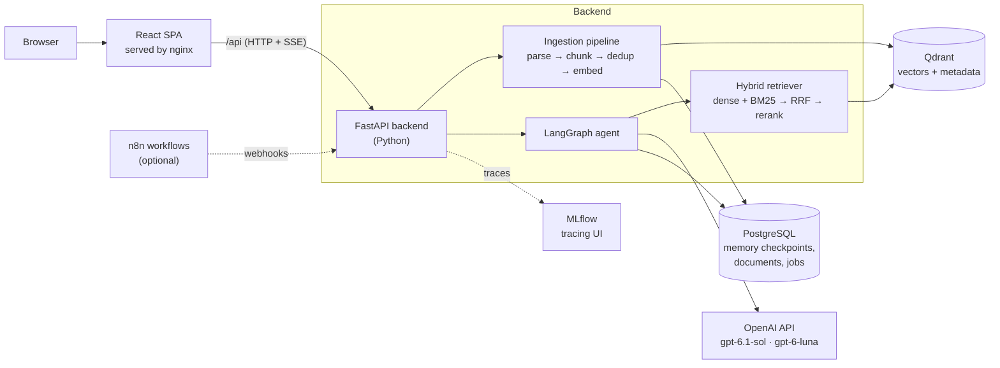
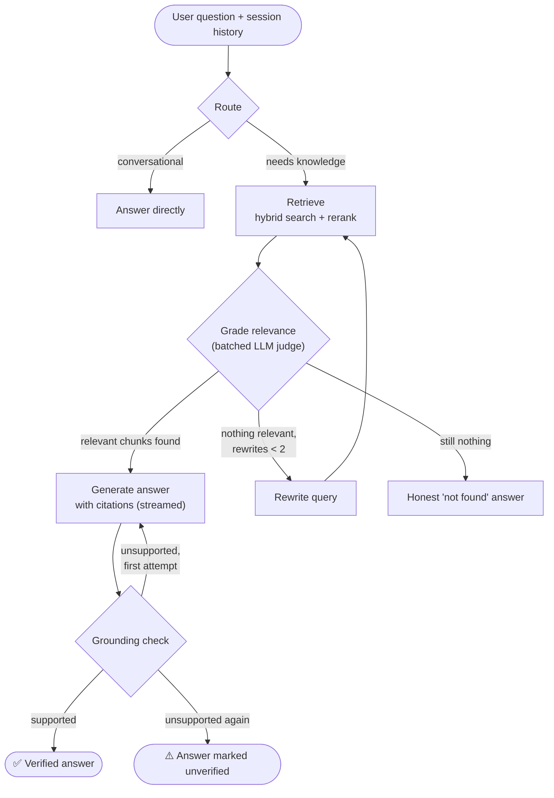

# MultiSource RAG Chatbot

**An agentic Retrieval-Augmented Generation (RAG) chatbot that answers questions from your documents and GitHub repositories, with cited, self-checked answers. It uses OpenAI models for reasoning and generation on top of a fully open-source retrieval stack that runs on a laptop with no GPU.**


> **Project status:** architecture, stack selection and the build plan are complete. Implementation is in progress, one milestone at a time. See the [Roadmap](#roadmap). This README describes the target system, and each feature is marked as built only when it's done and tested.

---

## Table of contents
- [Why this project](#why-this-project)
- [What it does](#what-it-does)
- [Architecture](#architecture)
- [The agentic pipeline](#the-agentic-pipeline)
- [Tech stack](#tech-stack)
- [Key engineering decisions](#key-engineering-decisions)
- [Engineering practices](#engineering-practices)
- [Roadmap](#roadmap)
- [Project structure](#project-structure)
- [Getting started](#getting-started)
- [Documentation](#documentation)
- [Skills demonstrated](#skills-demonstrated)
- [Author](#author)

---

## Why this project

Most RAG demos are a single "embed → search → prompt" script. They work on the happy path and fail quietly everywhere else. They hallucinate when retrieval misses, forget the conversation on restart, and give no visibility into *why* an answer was produced.

This project aims to build the version you could actually run in production, under deliberately tight constraints:

| Constraint | Why it matters |
|---|---|
| **No GPU.** Must run on a 16 GB Windows laptop. | Embeddings, reranking and all infrastructure run locally on CPU, which forces careful choices on model size and memory. |
| **Cost-aware LLM usage** | A paid API demands discipline: a cheap model for routing and judging, a stronger model only for the final answer, batched calls, bounded loops, token caps, and per-request cost tracking. |
| **Open source everywhere else** | Retrieval, storage, orchestration, UI and observability are all open source, so the only external dependency is the LLM, behind one swappable client. |
| **One-command deployment** | `docker compose up -d` brings up the entire system reproducibly. |
| **Observable by design** | Every agent step, retrieval and LLM call is traced and can be inspected. |

---

## What it does

| Capability | Description |
|---|---|
| **Multi-source ingestion** | PDF, Markdown, TXT and DOCX files, plus public GitHub repositories (shallow clone with file-type allow-lists and size limits). |
| **Structure-aware chunking** | Documents are converted to Markdown and split by headings, so each chunk keeps its section context. Source code is split along language structure. |
| **Hybrid retrieval** | Dense semantic vectors **and** BM25 keyword vectors are combined with **Reciprocal Rank Fusion**. This catches both paraphrases and exact identifiers such as error codes and function names. |
| **Cross-encoder reranking** | The top 20 candidates are re-scored by a cross-encoder, and only the best 5 reach the LLM. |
| **Agentic answering loop** | Route → retrieve → grade → rewrite → generate → grounding check, with bounded retries (details [below](#the-agentic-pipeline)). |
| **Cited, verified answers** | Answers cite their sources (`[1]`, `[2]`). A grounding check marks each answer *verified* or *unverified*, so the system is honest when it isn't sure. |
| **Persistent memory** | Per-session conversation state is checkpointed to PostgreSQL and survives restarts. |
| **Streaming** | Tokens and progress events ("retrieving…", "checking grounding…") stream to the browser over Server-Sent Events. |
| **React chat UI** | Sessions sidebar, live streaming, expandable source snippets, a Stop button, and document/repo upload with job progress. |
| **Full tracing** | Each request is one trace in MLflow, with spans for every graph node, retrieval and LLM call, including timings. |
| **Evaluation** *(stretch)* | An automated suite for retrieval quality (hit@k, MRR) and LLM-judged faithfulness, hallucination, relevancy and bias. |
| **Automation** *(stretch)* | n8n workflows, e.g. auto-ingest on new files and a nightly evaluation report. |

---

## Architecture



**Design principles**

- **Clear boundaries.** The frontend talks to the backend only through a documented HTTP/SSE contract under `/api`. In development the Vite proxy routes it, and in production nginx does. The browser sees a single origin, so no CORS configuration is needed.
- **Stateless API, stateful stores.** All durable state lives in Postgres (conversation memory, document registry, ingestion jobs) and Qdrant (vectors), on Docker volumes.
- **Configuration in the environment.** One typed settings object reads all configuration from environment variables, and no secrets live in code.

---

## The agentic pipeline

A plain RAG pipeline answers even when retrieval returned nothing useful, which is where hallucinations come from. This system makes explicit decisions at each step and gives up honestly when it can't find support.



- **Two model tiers.** `gpt-6-luna` (small, about 20× cheaper) handles the quick classification steps: route, grade and grounding check. `gpt-6.1-sol` writes the answers. Most LLM calls per question are therefore cheap and fast.
- **Bounded loops.** At most 2 query rewrites and 1 regeneration, so latency is predictable and the agent can't loop forever.
- **Structured outputs.** Every decision step returns strict-schema JSON (OpenAI structured outputs) validated by Pydantic, with safe fallbacks.
- **Cost and latency controls.** Minimal reasoning effort, max-token caps, timeouts, retries with backoff, and token usage plus estimated cost recorded for every request.

---

## Tech stack

Every component was chosen against a written comparison of the alternatives. The full tables are in [PLAN.md](PLAN.md#appendix--stack-comparison-tables).

| Layer | Technology | Why it was chosen |
|---|---|---|
| **LLM** | [OpenAI API](https://platform.openai.com): `gpt-6.1-sol` (generator), `gpt-6-luna` (router/judge), via `langchain-openai` | High-quality, fast answers; strict structured outputs; streaming; token-usage reporting |
| **Agent orchestration** | [LangGraph](https://github.com/langchain-ai/langgraph) | Explicit state graph with conditional edges and cycles; built-in Postgres checkpointing |
| **Embeddings & reranking** | [FastEmbed](https://github.com/qdrant/fastembed) (ONNX): bge-small, BM25, MiniLM cross-encoder | Fast on CPU with no PyTorch dependency; dense, sparse and reranking in one library |
| **Vector database** | [Qdrant](https://qdrant.tech) | Native hybrid search with server-side RRF fusion, payload filtering, one lightweight container |
| **Relational DB / memory** | PostgreSQL 17 | Durable conversation checkpoints plus the app's own tables in one reliable store |
| **Document parsing** | [MarkItDown](https://github.com/microsoft/markitdown), GitPython | One parser for all formats with structure preserved as Markdown; shallow repo cloning |
| **Backend API** | FastAPI, Uvicorn, SSE, Pydantic | Typed, async, auto-generated OpenAPI docs, first-class streaming |
| **Frontend** | React 19, Vite, react-markdown, CSS Modules | Modern single-page app, fast tooling, safe rendering of model output |
| **Observability** | MLflow Tracing, structlog | Automatic LangGraph tracing in a single container; structured JSON logs with request IDs |
| **Testing & quality** | pytest, Vitest, React Testing Library, Ruff, ESLint, Prettier | Unit and integration tests on both sides; strict linting and formatting |
| **Deployment** | Docker Compose, nginx, multi-stage builds | One command; nginx serves the SPA and proxies the streamed responses |
| **Evaluation** *(stretch)* | DeepEval + custom retrieval metrics | Faithfulness, hallucination, relevancy and bias, judged by an LLM |

---

## Key engineering decisions

Some highlights from the [design decision log](PLAN.md#5-key-design-decisions):

| Decision | Reasoning | Trade-off accepted |
|---|---|---|
| **Hosted LLM (OpenAI), with local embeddings and reranking** | Best answer quality and latency for the LLM step, while documents are embedded and reranked locally: only the top few chunks per question are ever sent to the API | Per-token cost and an external dependency, managed with budgets, caps and retries |
| **Two-tier model routing** | Cheap `gpt-6-luna` for classification, `gpt-6.1-sol` only for the final answer | Two model IDs to manage (both configurable) |
| **Hybrid search + RRF instead of vectors alone** | Dense vectors miss exact tokens (IDs, error codes). BM25 misses paraphrases. RRF fuses the two by rank, so no score normalization is needed. | Two vectors per chunk (negligible storage) |
| **Rerank 20 → 5 with a cross-encoder** | Accuracy where it matters, at bounded CPU cost | About 0.3–1 s extra per query |
| **Batched relevance grading** | One LLM call grades all candidates instead of N calls: lower cost, latency and rate-limit pressure | Slightly less precise than grading each chunk separately |
| **Stream first, verify after** | Users see tokens immediately, then a verified/unverified badge arrives | Text may be shown briefly before being flagged |
| **MLflow instead of Langfuse for tracing** | Self-hosted Langfuse needs Postgres, ClickHouse, Redis and MinIO (about 16 GB recommended), which is too heavy for a 16 GB laptop. MLflow is one container. | A less specialized LLM-observability UI |
| **ONNX models instead of PyTorch** | About 200 MB instead of several GB; fast and painless on Windows CPU | A smaller model catalogue |
| **Deterministic chunk IDs + content hashing** | Re-ingesting is safe and skips unchanged files | Changing chunk settings requires a re-index |
| **Same-origin `/api` proxy** | No CORS surface and no hard-coded hosts in the frontend | A proxy layer to configure |

Risks were assessed up front, including API cost runaway, key leakage, rate limits, data privacy, a 16 GB memory budget, malformed model output, prompt injection from ingested content, and SSE buffering behind proxies. Each has a planned mitigation, documented in [PLAN.md](PLAN.md#6-risks--mitigations).

---

## Engineering practices

- **Plan-first workflow.** Every milestone starts with a written plan and an explicit definition of done, and ends with verification and a log entry ([MEMORY.md](MEMORY.md)).
- **Reproducible dependencies.** Every Python and npm package is pinned to an exact version. The full Python set was resolved against Python 3.12 on Windows (binary wheels only) and the npm set was checked for peer conflicts before any code was written. Docker images are pinned to exact tags.
- **Testing strategy.** Unit tests for pure logic (chunking, rank fusion, SSE parsing, routing), agent-path tests using a fake LLM, integration tests against real services, and an end-to-end smoke test against the containers.
- **Security-minded.**
  - Ingested text is treated as untrusted data (prompt-injection-aware prompts).
  - Code from ingested repos is never executed.
  - Uploads are size- and type-validated.
  - Model output is rendered without raw HTML (XSS-safe).
  - There are no secrets in the frontend or in git.
- **Observability from day one.** Tracing is added before the agent is built, so every later behaviour can be inspected.
- **Measured, not assumed.** Retrieval strategies (dense, sparse, hybrid, hybrid + rerank) are compared with hit@k and MRR on a golden dataset.

---

## Roadmap

Built in 7 phases (10 milestones plus 2 stretch goals). Each phase ends in a demoable milestone, and each milestone has explicit deliverables and a definition of done ([full plan](PLAN.md#4-build-phases--sessions)).

| Phase | # | Milestone | Status |
|---|---|---|---|
| 0 · Design | 0 | Architecture, stack selection, build plan, dev-environment spec | ✅ Done |
| 1 · Foundation | 1 | Config, logging, health/readiness API, Dockerised infrastructure | ✅ Done |
| 2 · Knowledge pipeline | 2 | Document loading & structure-aware chunking | ⏳ Next |
| | 3 | Embeddings & indexing (Qdrant + Postgres document registry) | 🔲 Planned |
| 3 · Retrieval & sources | 4 | Hybrid retrieval, reranking & retrieval metrics | 🔲 Planned |
| | 5 | GitHub repo ingestion & ingestion API with background jobs | 🔲 Planned |
| 4 · Agent intelligence | 6 | OpenAI integration, baseline RAG & MLflow tracing | 🔲 Planned |
| | 7 | Agentic loop in LangGraph | 🔲 Planned |
| 5 · Product experience | 8 | Persistent memory & streaming chat API | 🔲 Planned |
| | 9 | React chat UI | 🔲 Planned |
| 6 · Production | 10 | One-command deployment & hardening | 🔲 Planned |
| 7 · Stretch | A | Evaluation of hallucination, accuracy and bias | 🔲 Planned |
| | B | n8n automation workflows | 🔲 Planned |

---

## Project structure

The target layout, with folders added as milestones are built:

```
.
├── app/                    # Python backend (FastAPI + LangGraph)
│   ├── api/                # HTTP routes & schemas (all under /api)
│   ├── agent/              # graph, nodes, prompts, LLM clients
│   ├── retrieval/          # embeddings, Qdrant store, reranker, hybrid retriever
│   ├── ingestion/          # loaders, GitHub cloning, chunking, pipeline
│   ├── memory/             # Postgres checkpointer
│   ├── db/                 # connection pool, schema, repositories
│   └── observability/      # tracing & request IDs
├── frontend/               # React + Vite single-page app
│   └── src/{api,hooks,components}
├── evals/                  # golden datasets & evaluation scripts
├── tests/                  # unit & integration tests
├── docker/                 # Dockerfiles & DB init
└── docker-compose.yml      # the whole system, one command
```

---

## Getting started

> These commands work once the corresponding milestone is complete. Full Windows instructions, with a verification step for each install, are in [SETUP.md](SETUP.md).

**Prerequisites:** Docker with Compose (e.g. Rancher Desktop), Python 3.12, Node.js 24 LTS, and an **OpenAI API key** (set a project budget limit). A laptop with 8–16 GB of RAM is enough; no GPU is needed.

```bash
git clone https://github.com/rgambhir777-rgb/MultiSourceRagChatbot.git
cd MultiSourceRagChatbot
cp .env.example .env        # then set OPENAI_API_KEY in .env

# Full system (milestone 10)
docker compose up -d --build
```

| Service | URL |
|---|---|
| Chat app | http://localhost:8080 |
| API docs (Swagger) | http://localhost:8000/docs |
| Tracing (MLflow) | http://localhost:5000 |
| Vector DB dashboard | http://localhost:6333/dashboard |

---

## Documentation

| Document | Contents |
|---|---|
| [PLAN.md](PLAN.md) | Architecture, component explanations, milestones, design decisions, risks, stack comparisons |
| [CLAUDE.md](CLAUDE.md) | Project rules, locked stack, coding standards for Python and React |
| [SETUP.md](SETUP.md) | Windows setup with verification steps and troubleshooting |
| [MEMORY.md](MEMORY.md) | Development log: what was built, verified and decided in each milestone |
| [GLOSSARY.md](GLOSSARY.md) | Plain-language definitions of every term used in the project |

---

## Skills demonstrated

- **AI / LLM engineering:** RAG system design, hybrid retrieval, reranking, agentic workflows with LangGraph, structured LLM outputs, LLM-as-judge, hallucination mitigation, prompt-injection defence, OpenAI API integration with cost and latency control.
- **Backend engineering:** Python, FastAPI, async I/O, Server-Sent Events streaming, PostgreSQL, vector databases, background jobs, idempotent data pipelines.
- **Frontend engineering:** React, custom hooks, streaming UIs over `fetch`/`ReadableStream`, accessible and XSS-safe rendering.
- **MLOps / DevOps:** Docker Compose, multi-stage builds, nginx reverse proxy, health and readiness checks, tracing and structured logging, evaluation pipelines.
- **Engineering judgment:** documented trade-off analysis, resource- and cost-constrained design (no GPU, 16 GB, per-token budget), risk assessment, test strategy, reproducible builds.

---

## Author

**[@rgambhir777-rgb](https://github.com/rgambhir777-rgb)**

Questions and feedback are welcome. Open an [issue](https://github.com/rgambhir777-rgb/MultiSourceRagChatbot/issues).
